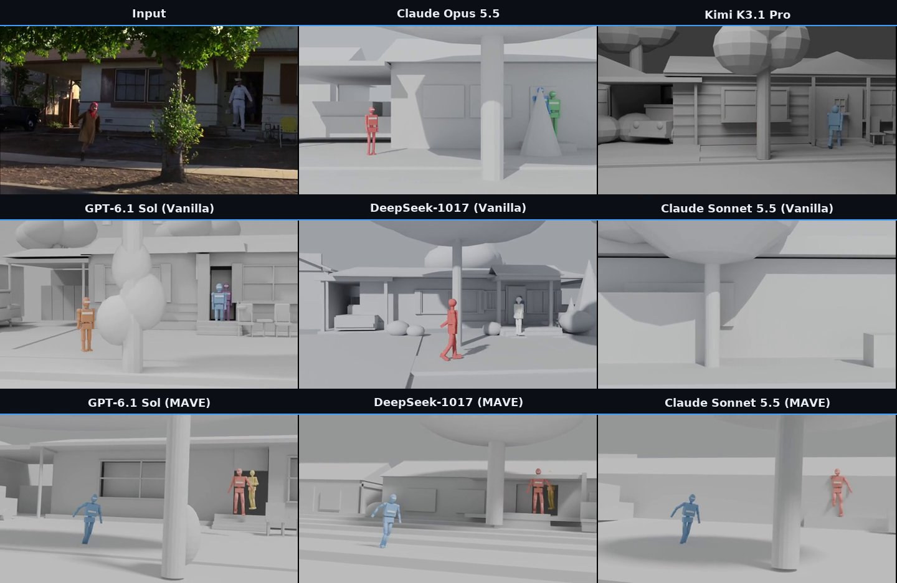
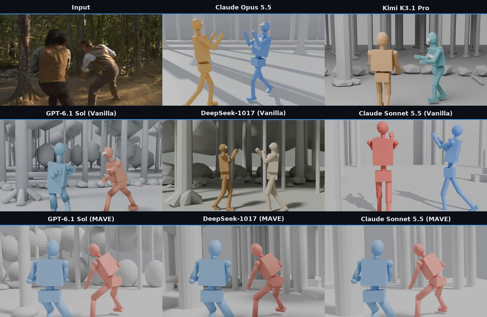
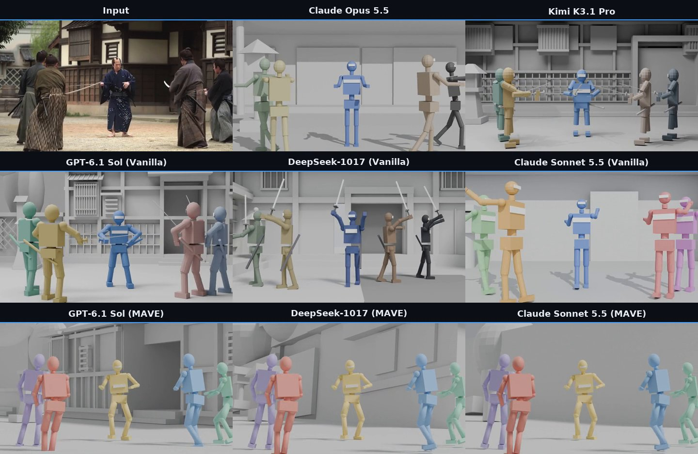
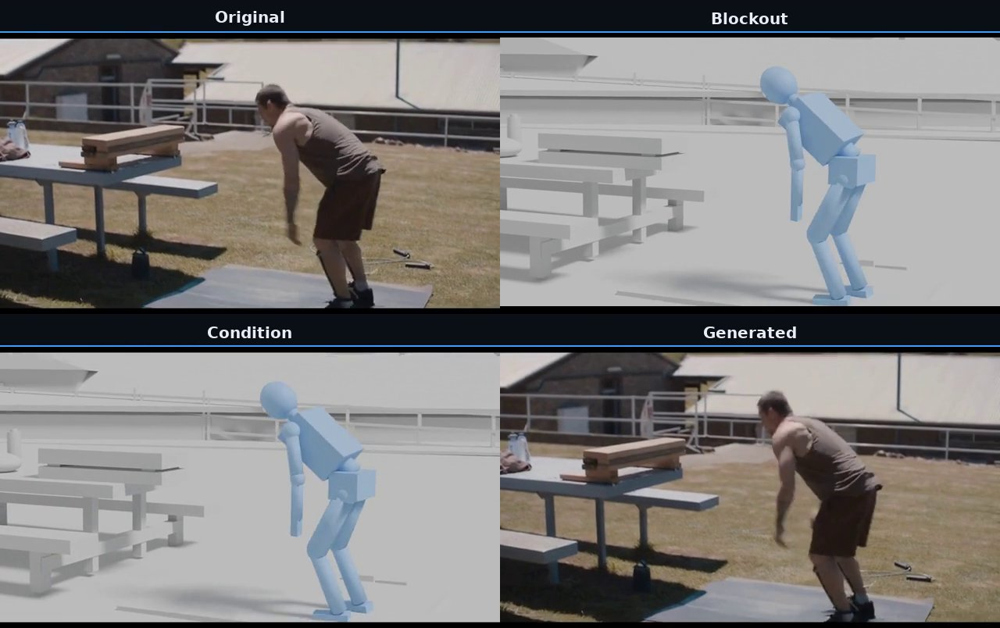
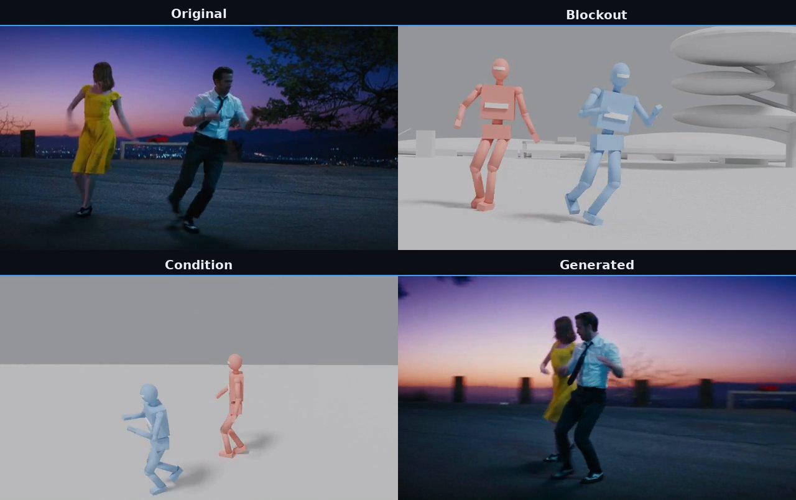
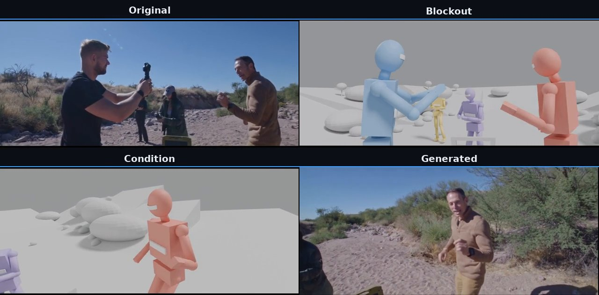
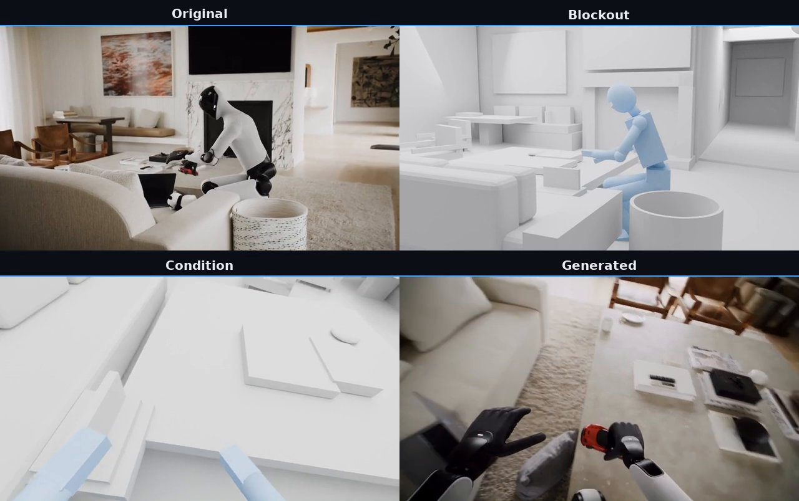

<div align="center">

<h1>
MAVE: Reconstructing Editable 3D Blockouts<br>
from Film Shots
</h1>


[](https://arxiv.org/abs/2611.22464)
[](https://yfChang-cv.github.io/MAVE/)
[](https://huggingface.co/datasets/yfChang/MAVE)
[](https://huggingface.co/datasets/yfChang/MAVE-film)

**Yifan Chang<sup>1,2,5\*</sup>, Jian Yang<sup>1,3\*</sup>, Jiangnan Shao<sup>1,4\*</sup>, Xiaofeng Wang<sup>6</sup>,**<br>
**Zhaoxin Fan<sup>7</sup>, Renjing Xu<sup>4</sup>, Ming Lu<sup>8</sup>, Xingang Wang<sup>2</sup>, Zheng Zhu<sup>1</sup>**

<sup>1</sup>GigaAI &nbsp; <sup>2</sup>CASIA &nbsp; <sup>3</sup>RUC &nbsp; <sup>4</sup>HKUST (GZ)<br>
<sup>5</sup>UCAS &nbsp; <sup>6</sup>THU &nbsp; <sup>7</sup>BUAA &nbsp; <sup>8</sup>ZPark IPC

<sup>\*</sup>Equal contribution

</div>

## 🔥 News

- **[2026.11]** Paper is available on [arXiv](https://arxiv.org/abs/2611.22464).
- **[2026.11]** Repository is online. Code, MAVEBench, and MAVEData-3K will be released soon.

## 📌 Release Status

- ✅ ~~Paper ([arXiv](https://arxiv.org/abs/2611.22464))~~
- [ ] Project page ([GitHub Pages](https://yfChang-cv.github.io/MAVE/))
- [ ] Code of MAVE (**public**)
- [ ] Our annotations (**public**)
- [ ] MAVEBench evaluation & film media (**Hugging Face gated**, upon request)
- [ ] MAVEData-3K film media (**Hugging Face gated**, upon request)

## 🔓 Access Policy

| Content | Access |
| --- | --- |
| **Code** | Public (this repository) |
| **Our annotations** | Public: [`yfChang/MAVE`](https://huggingface.co/datasets/yfChang/MAVE) |
| **Film source media** (MAVEBench / MAVEData-3K) | Gated: [`yfChang/MAVE-film`](https://huggingface.co/datasets/yfChang/MAVE-film) — request access |

HF gating is repo-wide, so we publish **two datasets in one Collection**: [MAVE](https://huggingface.co/collections/yfChang/mave-6afc28d150cd379e072c4d9e). Annotations stay publicly downloadable; film media requires manual approval. Details: [`docs/huggingface_release.md`](./docs/huggingface_release.md).

Film shots remain copyrighted by their original rights holders. We release our own annotations publicly; film media is distributed only after gated access is approved for research use. Data files will be uploaded when ready.

## 📖 Abstract

Animated 3D blockouts support previsualization and provide structural conditions for video generation, but manually reconstructing them from reference videos is costly. We introduce **MAVEBench**, a benchmark of 50 film shots and 416 keyframes for evaluating camera motion, spatial layout, and character blocking. We propose **MAVE**, a video-to-blockout framework combining **M**etric observation, **A**gentic modeling, and evidence-based **VE**rification. It recovers cameras, human motion, and geometric evidence in a shared metric coordinate system, then constructs an editable environment under observation constraints with programmatic checks for refinement. The outputs are editable Blender scenes and frame-aligned blockout videos. On MAVEBench, MAVE improves overall scores by **27.5–41.1** points across three agents over vanilla baselines. With DeepSeek-1017, it achieves a score of **73.2** at only **$0.054** average API cost per shot, while reducing total reconstruction time by **53%**. We also construct **MAVEData-3K**, a dataset of 3,000 blockout–video pairs for public release. Creators can change viewpoints and character paths, then render the edited scenes to condition video generation.

## 🧩 Overview

| Component | Description | Access |
| --- | --- | --- |
| [`code/`](./code) | MAVE pipeline: Metric Observation → Agentic Modeling → Evidence-Based Verification | Public (coming soon) |
| [`benchmark/`](./benchmark) | **MAVEBench** annotations & evaluation; film media via HF gated | Annotations public · media gated |
| [`dataset/`](./dataset) | **MAVEData-3K** pairs; film media via HF gated | Annotations public · media gated |
| [`assets/`](./assets) | Figures and demo materials | Public |

## 🛠️ Method

<p align="center">
  
  <br>
  <em>MAVE pipeline: Metric Observation → Agentic Modeling → Evidence-Based Verification.</em>
</p>

MAVE reconstructs editable blockouts in three stages:

1. **Metric Observation** — recover cameras, human motion, and geometric evidence in a shared metric frame  
2. **Agentic Modeling** — construct named, editable scene primitives under observation constraints  
3. **Evidence-Based Verification** — report depth conflicts, missing coverage, and human–environment inconsistencies for refinement  

Detailed installation and inference instructions will be added with the code release.

## 🎬 Qualitative Comparison

Click a preview to open the MP4 (GitHub’s built-in player). Interactive tabs: [project page](https://yfChang-cv.github.io/MAVE/#comparison) (coming soon).


https://github.com/user-attachments/assets/33080d7e-4381-41d3-8f63-ae4c125d7bb0


https://github.com/user-attachments/assets/c783ee84-57ff-4f5c-af7a-f74281cbd3fe


https://github.com/user-attachments/assets/98a1c71e-5b8c-4480-b909-dc1c907541f7


<p align="center">
  <a href="https://github.com/yfChang-cv/MAVE/blob/main/assets/compare_method/mosaic/R238_compare3x3.mp4">
    
  </a>
</p>

<p align="center">
  <a href="https://github.com/yfChang-cv/MAVE/blob/main/assets/compare_method/mosaic/F031_compare3x3.mp4">
    
  </a>
</p>

<p align="center">
  <a href="https://github.com/yfChang-cv/MAVE/blob/main/assets/compare_method/mosaic/F076_compare3x3.mp4">
    
  </a>
</p>

## 🎯 Applications


https://github.com/user-attachments/assets/973d696d-79da-4de0-b8d6-7ff763e56e5a


https://github.com/user-attachments/assets/2b853f7d-6ec7-4dec-98eb-6b771e6a222f


https://github.com/user-attachments/assets/39587728-714c-45c8-a409-6ff415d21da7


https://github.com/user-attachments/assets/5d3d4410-e648-46ea-9d7d-0dc80cd16287


https://github.com/user-attachments/assets/9c5567d4-7f53-4ad0-974d-4b0aec56a394


https://github.com/user-attachments/assets/e3d26414-454e-4ec9-9088-298b932783af


<p align="center"><b>Change character trajectory</b> · <a href="https://github.com/yfChang-cv/MAVE/blob/main/assets/application/01_change_trajectory/r195-jump-bench-left/r195-jump-bench-left_mosaic.mp4">▶ video</a></p>
<p align="center">
  <a href="https://github.com/yfChang-cv/MAVE/blob/main/assets/application/01_change_trajectory/r195-jump-bench-left/r195-jump-bench-left_mosaic.mp4">
    
  </a>
</p>

<p align="center"><b>Change camera trajectory</b> · <a href="https://github.com/yfChang-cv/MAVE/blob/main/assets/application/02_change_camera/1-orbit-loop/1-orbit-loop_mosaic.mp4">▶ video</a></p>
<p align="center">
  <a href="https://github.com/yfChang-cv/MAVE/blob/main/assets/application/02_change_camera/1-orbit-loop/1-orbit-loop_mosaic.mp4">
    
  </a>
</p>

<p align="center"><b>Person exo→ego</b> · <a href="https://github.com/yfChang-cv/MAVE/blob/main/assets/application/03_person_exo2ego/r116-openai-ego-full/r116-openai-ego-full_mosaic.mp4">▶ video</a></p>
<p align="center">
  <a href="https://github.com/yfChang-cv/MAVE/blob/main/assets/application/03_person_exo2ego/r116-openai-ego-full/r116-openai-ego-full_mosaic.mp4">
    
  </a>
</p>

<p align="center"><b>Robot exo→ego</b> · <a href="https://github.com/yfChang-cv/MAVE/blob/main/assets/application/04_robot_exo2ego/robot-cleanup-ego-v1/robot-cleanup-ego-v1_mosaic.mp4">▶ video</a></p>
<p align="center">
  <a href="https://github.com/yfChang-cv/MAVE/blob/main/assets/application/04_robot_exo2ego/robot-cleanup-ego-v1/robot-cleanup-ego-v1_mosaic.mp4">
    
  </a>
</p>

## 📊 MAVEBench

MAVEBench evaluates video-to-blockout reconstruction on **50 film shots** along three axes: camera motion, spatial layout, and character blocking. Total is the mean of the three axis scores (0–100). **Best** / <u>second-best</u> among reconstruction methods are highlighted. All MAVE runs share cameras from Metric Observation.

<p align="center"><b>Reconstruction quality</b></p>

<div align="center">

| Method | ORE↓ | RRA@15↑ | RTA@15↑ | Cam.↑ | OrdAcc↑ | HOTA↑ | MaskIoU↑ | Char.↑ | Total↑ |
| :--- | :---: | :---: | :---: | :---: | :---: | :---: | :---: | :---: | :---: |
| No Reconstruction | 0.168 | 0.000 | 0.000 | 0.000 | 0.000 | 0.000 | 0.000 | 0.000 | 0.0 |
| *Vanilla* | | | | | | | | | |
| GPT-6.1 Sol | <u>0.060</u> | <u>0.571</u> | 0.215 | <u>0.477</u> | 0.609 | 0.421 | 0.324 | 0.373 | 48.6 |
| Claude Opus 5.5 | 0.077 | 0.542 | <u>0.247</u> | 0.444 | 0.585 | 0.264 | 0.175 | 0.220 | 41.6 |
| DeepSeek-1017 | 0.123 | 0.430 | 0.184 | 0.293 | 0.596 | 0.260 | 0.191 | 0.226 | 37.2 |
| Claude Sonnet 5.5 | 0.135 | 0.346 | 0.209 | 0.250 | 0.534 | 0.195 | 0.131 | 0.163 | 31.6 |
| Kimi K3.1 Pro | 0.156 | 0.208 | 0.185 | 0.155 | 0.511 | 0.215 | 0.152 | 0.183 | 28.3 |
| **MAVE (Ours)** | | | | | | | | | |
| GPT-6.1 Sol | **0.005** | **1.000** | **0.844** | **0.938** | **0.781** | **0.627** | **0.499** | **0.563** | **76.1** |
| DeepSeek-1017 | **0.005** | **1.000** | **0.844** | **0.938** | <u>0.717</u> | 0.604 | 0.478 | 0.541 | <u>73.2</u> |
| Claude Sonnet 5.5 | **0.005** | **1.000** | **0.844** | **0.938** | 0.695 | <u>0.612</u> | <u>0.485</u> | <u>0.548</u> | 72.7 |

</div>

<p align="center"><b>Reconstruction efficiency</b> &nbsp;·&nbsp; <i>+ Metric Observation: 1m28s</i></p>

<div align="center">

| Method | Agent Time↓ | # Primitives | Cost↓ | Total↑ |
| :--- | :---: | :---: | :---: | :---: |
| *Vanilla* | | | | |
| GPT-6.1 Sol | 22m41s | 273.1 | $0.385 | 48.6 |
| Claude Opus 5.5 | 15m50s | 36.4 | $0.644 | 41.6 |
| DeepSeek-1017 | 20m25s | 182.3 | <u>$0.074</u> | 37.2 |
| Claude Sonnet 5.5 | **3m46s** | 67.7 | $0.341 | 31.6 |
| Kimi K3.1 Pro | 24m53s | 271.2 | $0.368 | 28.3 |
| **MAVE (Ours)** | | | | |
| GPT-6.1 Sol | 13m11s | 115.5 | $0.445 | **76.1** |
| DeepSeek-1017 | 9m17s | 68.3 | **$0.054** | <u>73.2</u> |
| Claude Sonnet 5.5 | <u>4m36s</u> | 20.9 | $0.363 | 72.7 |

</div>

**Access.** Our annotations and evaluation scripts will be public ([`benchmark/`](./benchmark) + [`yfChang/MAVE`](https://huggingface.co/datasets/yfChang/MAVE)). Film source media: request access at [`yfChang/MAVE-film`](https://huggingface.co/datasets/yfChang/MAVE-film).

## 📦 MAVEData-3K (Coming Soon)

MAVEData-3K contains **3,000** blockout–video pairs. Each reconstructed scene is rendered with the recovered camera trajectory to produce a frame-aligned blockout video for training blockout-conditioned generation models.

**Access.** Our annotations / derived metadata: [`yfChang/MAVE`](https://huggingface.co/datasets/yfChang/MAVE). Film-related media: gated [`yfChang/MAVE-film`](https://huggingface.co/datasets/yfChang/MAVE-film). See [`dataset/`](./dataset).

## 📁 Repository Structure

```text
MAVE/
├── assets/        # teaser & demo materials
├── code/          # MAVE implementation (coming soon)
├── benchmark/     # MAVEBench data & evaluation (coming soon)
├── dataset/       # MAVEData-3K release (coming soon)
└── README.md
```

## 📝 Citation

If you find MAVE useful, please cite:

```bibtex
@misc{chang2026mavereconstructingeditable3d,
      title={MAVE: Reconstructing Editable 3D Blockouts from Film Shots}, 
      author={Yifan Chang and Jian Yang and Jiangnan Shao and Xiaofeng Wang and Zhaoxin Fan and Renjing Xu and Ming Lu and Xingang Wang and Zheng Zhu},
      year={2026},
      eprint={2611.22464},
      archivePrefix={arXiv},
      primaryClass={cs.CV},
      url={https://arxiv.org/abs/2611.22464}, 
}
```

## 📮 Contact

For questions about MAVE, MAVEBench, or MAVEData-3K, please open an [issue](https://github.com/yfChang-cv/MAVE/issues).

## 📄 License

- **Code** — will be released under an open-source license (to be announced).  
- **Our annotations** — public for research use (license to be announced).  
- **Film source media** — copyright remains with the original rights holders; distributed only via Hugging Face gated access for approved research use.
