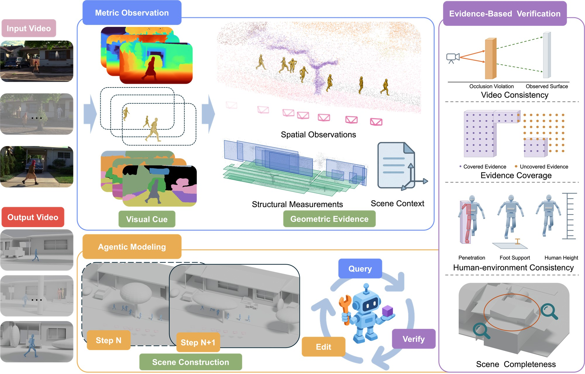
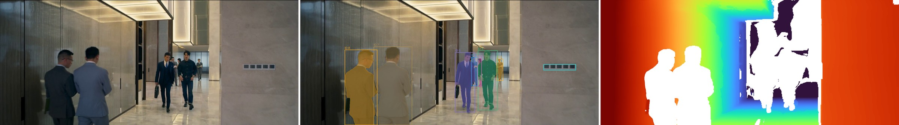

# MAVE-film

<p align="center">
  <a href="https://yfChang-cv.github.io/MAVE/">
    
  </a>
</p>

<p align="center">
  <a href="https://yfChang-cv.github.io/MAVE/">🌐 Website</a> ·
  <a href="https://arxiv.org/abs/2611.22464">📑 arXiv</a> ·
  <a href="https://github.com/yfChang-cv/MAVE">💻 GitHub</a> ·
  <a href="https://huggingface.co/datasets/yfChang/MAVE">📦 Annotations (public)</a> ·
  <a href="https://huggingface.co/collections/yfChang/mave-6afc28d150cd379e072c4d9e">📚 Collection</a>
</p>

<p align="center"><strong>Film source media for MAVE / MAVEBench</strong></p>

This gated repository hosts **film source clips** used by **MAVEBench** (50 shots). **MAVE** reconstructs editable 3D blockouts from film shots via Metric Observation, Agentic Modeling, and Evidence-Based Verification. Our annotations and evaluation indices are public in [`yfChang/MAVE`](https://huggingface.co/datasets/yfChang/MAVE); this repo only distributes the corresponding film media for approved non-commercial research.

| Content | Access |
| --- | --- |
| Film shots / videos | **This repo (gated, manual approval)** |
| Our annotations | Public: [`yfChang/MAVE`](https://huggingface.co/datasets/yfChang/MAVE) |

## Overview



*MAVE pipeline: Metric Observation → Agentic Modeling → Evidence-Based Verification.*



*Example MAVEBench annotations paired with film (R089): film frame, people / object annotations, and depth (left → right). Annotations live in the public sibling repo.*

## What's included

```text
MAVE-film/
├── README.md
├── NOTICE
├── assets/                      # dataset-card figures
└── mavebench/
    └── shots/<shot_id>/video.mp4
```

Paths match `media_index.json` in the public [`yfChang/MAVE`](https://huggingface.co/datasets/yfChang/MAVE) dataset.

## Access

1. Fill the request form (name, affiliation, email, research purpose, non-commercial / no-redistribution agreement).
2. Wait for manual approval.
3. Download with an authenticated Hugging Face token:

```bash
hf download yfChang/MAVE-film --local-dir data/MAVE-film
```

Annotations do **not** require this form: [`yfChang/MAVE`](https://huggingface.co/datasets/yfChang/MAVE).

## Terms (summary)

- Non-commercial research only
- No redistribution of film files
- No person identification / profiling
- Copyright remains with original rights holders
- Access may be revoked

Full text: [`NOTICE`](NOTICE).

## Takedown / copyright concerns

Film clips remain copyrighted by their original rights holders. We distribute them only for approved non-commercial research and do not claim ownership.

If you are a rights holder (or an authorized representative) and believe material in this repository infringes your copyright, please contact us to request removal. We will review the request and take down the relevant files when appropriate.

- Open a discussion on this dataset page, or
- Open an issue on [GitHub](https://github.com/yfChang-cv/MAVE/issues), or
- Email the authors listed in the [MAVE paper](https://arxiv.org/abs/2611.22464)

Please include the shot id / file path and evidence of ownership or authorization.

## Citation

[arXiv:2611.22464](https://arxiv.org/abs/2611.22464) · [PDF](https://arxiv.org/pdf/2611.22464) · [Project page](https://yfChang-cv.github.io/MAVE/) · [Annotations](https://huggingface.co/datasets/yfChang/MAVE)

If you use this film media together with MAVE / MAVEBench, please cite:

**MAVE: Reconstructing Editable 3D Blockouts from Film Shots (2026).**

```bibtex
@misc{chang2026mavereconstructingeditable3d,
      title={MAVE: Reconstructing Editable 3D Blockouts from Film Shots}, 
      author={Yifan Chang and Jian Yang and Jiangnan Shao and Xiaofeng Wang and Zhaoxin Fan and Renjing Xu and Ming Lu and Xingang Wang and Zheng Zhu},
      year={2026},
      eprint={2611.22464},
      archivePrefix={arXiv},
      primaryClass={cs.CV},
      url={https://arxiv.org/abs/2611.22464}, 
}
```
