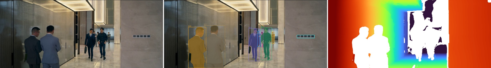

---
language:
- en
license: cc-by-nc-4.0
task_categories:
- other
size_categories:
- n<1K
pretty_name: MAVE
tags:
- benchmark
- blockout
- previsualization
- blender
- 3d
- video
- mavebench
- camera
- human-motion
---

# MAVE

<p align="center">
  <a href="https://yfChang-cv.github.io/MAVE/">
    
  </a>
</p>

<p align="center">
  <a href="https://yfChang-cv.github.io/MAVE/">🌐 Website</a> ·
  <a href="https://arxiv.org/abs/2611.22464">📑 arXiv</a> ·
  <a href="https://github.com/yfChang-cv/MAVE">💻 GitHub</a> ·
  <a href="https://huggingface.co/datasets/yfChang/MAVE-film">🎬 Film media (gated)</a> ·
  <a href="https://huggingface.co/collections/yfChang/mave-6afc28d150cd379e072c4d9e">📦 Collection</a>
</p>

<p align="center"><strong>MAVE: Reconstructing Editable 3D Blockouts from Film Shots</strong></p>

<p align="center">
Yifan Chang, Jian Yang, Jiangnan Shao, Xiaofeng Wang,<br>
Zhaoxin Fan, Renjing Xu, Ming Lu, Xingang Wang, Zheng Zhu
</p>

Animated 3D blockouts support previsualization and provide structural conditions for video generation, but manually reconstructing them from reference videos is costly. We introduce **MAVEBench**, a benchmark of **50 film shots** and **416 keyframes** for evaluating camera motion, spatial layout, and character blocking. We propose **MAVE**, a video-to-blockout framework combining **M**etric observation, **A**gentic modeling, and evidence-based **VE**rification. It recovers cameras, human motion, and geometric evidence in a shared metric coordinate system, then constructs an editable environment under observation constraints with programmatic checks for refinement. The outputs are editable Blender scenes and frame-aligned blockout videos. On MAVEBench, MAVE improves overall scores by **27.5–41.1** points across three agents over vanilla baselines. With DeepSeek-1017, it achieves a score of **73.2** at only **$0.054** average API cost per shot, while reducing total reconstruction time by **53%**.

This Hugging Face repository hosts **our annotations and indices** for MAVEBench. Film source media is distributed separately under gated access in [`yfChang/MAVE-film`](https://huggingface.co/datasets/yfChang/MAVE-film). The [GitHub repository](https://github.com/yfChang-cv/MAVE) provides evaluation code and the MAVE pipeline.
## Dataset at a glance


*MAVE pipeline: Metric Observation → Agentic Modeling → Evidence-Based Verification.*

| Subset | Shots | Keyframes | Contents in this repo |
| --- | ---: | ---: | --- |
| **MAVEBench** | 50 | 416 | Cameras, depth, people, static objects, splits, `media_index.json` |

### Inputs and ground truth



*Example MAVEBench shot (R089, keyframe): film frame, people / object annotations, and depth (left → right). Film clips themselves are in the gated sibling repo.*

## Quickstart

### Download annotations

```bash
hf download yfChang/MAVE --local-dir data/MAVE
```

### Download film media (after access approval)

```bash
# request access: https://huggingface.co/datasets/yfChang/MAVE-film
hf download yfChang/MAVE-film --local-dir data/MAVE-film
```

Suggested layout for the evaluator in [`code/eval`](https://github.com/yfChang-cv/MAVE/tree/main/code/eval):

```text
benchmark/mavebench/   ← this repo's mavebench/
benchmark/film/        ← yfChang/MAVE-film (mavebench/shots/…)
```

Or with Python:

```python
from huggingface_hub import snapshot_download

snapshot_download(repo_id="yfChang/MAVE", repo_type="dataset", local_dir="data/MAVE")
```

## Dataset structure

```text
LICENSE
NOTICE
SHA256SUMS
assets/                      # dataset-card figures
mavebench/
  annotations/<shot_id>/
    clip.json                # keyframes and clip metadata
    camera/sfm.json
    depth/kf_*.npz
    people/people.json
    people/masks/
    ore/objects.json
  splits/                    # shot list / clip indices
  eval/                      # protocol notes
  media_index.json           # shot_id → path in yfChang/MAVE-film + sha256
```

`media_index.json` maps each shot to its film path and checksum in the gated repo. See [`docs/media_index.schema.json`](https://github.com/yfChang-cv/MAVE/blob/main/docs/media_index.schema.json) on GitHub.

## Evaluation

MAVEBench scores a method’s `scene.blend` on three axes (0–100 total = mean of the three):

| Axis | Metrics |
| --- | --- |
| **Camera motion** | ORE, RRA@15, RTA@15 |
| **Spatial layout** | Ordinal Acc |
| **Character blocking** | HOTA, Mask IoU |

Keyframe index `i` of a shot is video frame `clip.json["keyframes"][i]` (0-based). In a method’s Blender scene it corresponds to frame `keyframes[i] + 1`.

Full commands: [code/eval on GitHub](https://github.com/yfChang-cv/MAVE/tree/main/code/eval).

## License and responsible use

Annotations and indices are released under [CC BY-NC 4.0](LICENSE).
Film source media remain with their original rights holders and are **not** covered by this license; see [`yfChang/MAVE-film`](https://huggingface.co/datasets/yfChang/MAVE-film) and [`NOTICE`](NOTICE). Do not redistribute film media without permission. Do not use this release to identify or profile individuals shown in the footage.

## Citation

[arXiv:2611.22464](https://arxiv.org/abs/2611.22464) · [PDF](https://arxiv.org/pdf/2611.22464) · [Project page](https://yfChang-cv.github.io/MAVE/) · [GitHub](https://github.com/yfChang-cv/MAVE)

If you use MAVE, MAVEBench, or this dataset, please cite:

**MAVE: Reconstructing Editable 3D Blockouts from Film Shots (2026).**

```bibtex
@misc{chang2026mavereconstructingeditable3d,
      title={MAVE: Reconstructing Editable 3D Blockouts from Film Shots}, 
      author={Yifan Chang and Jian Yang and Jiangnan Shao and Xiaofeng Wang and Zhaoxin Fan and Renjing Xu and Ming Lu and Xingang Wang and Zheng Zhu},
      year={2026},
      eprint={2611.22464},
      archivePrefix={arXiv},
      primaryClass={cs.CV},
      url={https://arxiv.org/abs/2611.22464}, 
}
```
